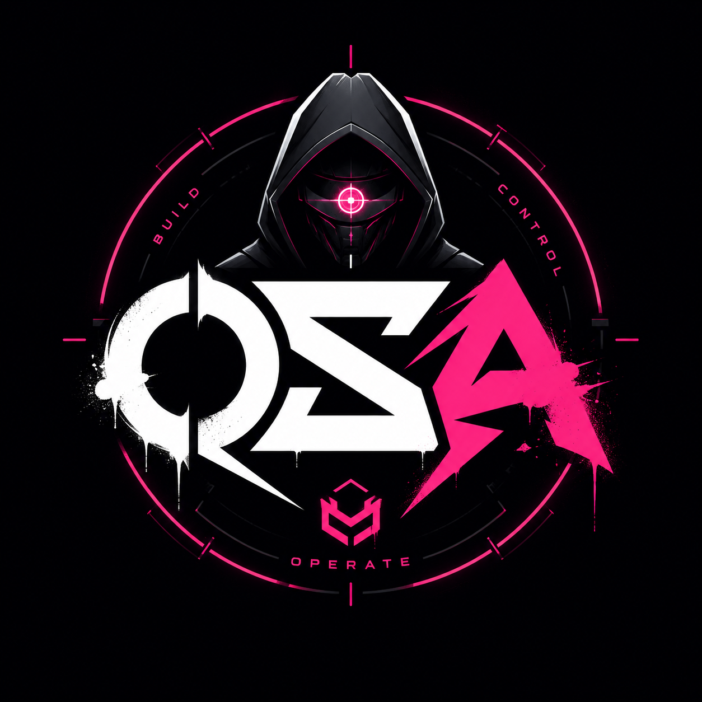
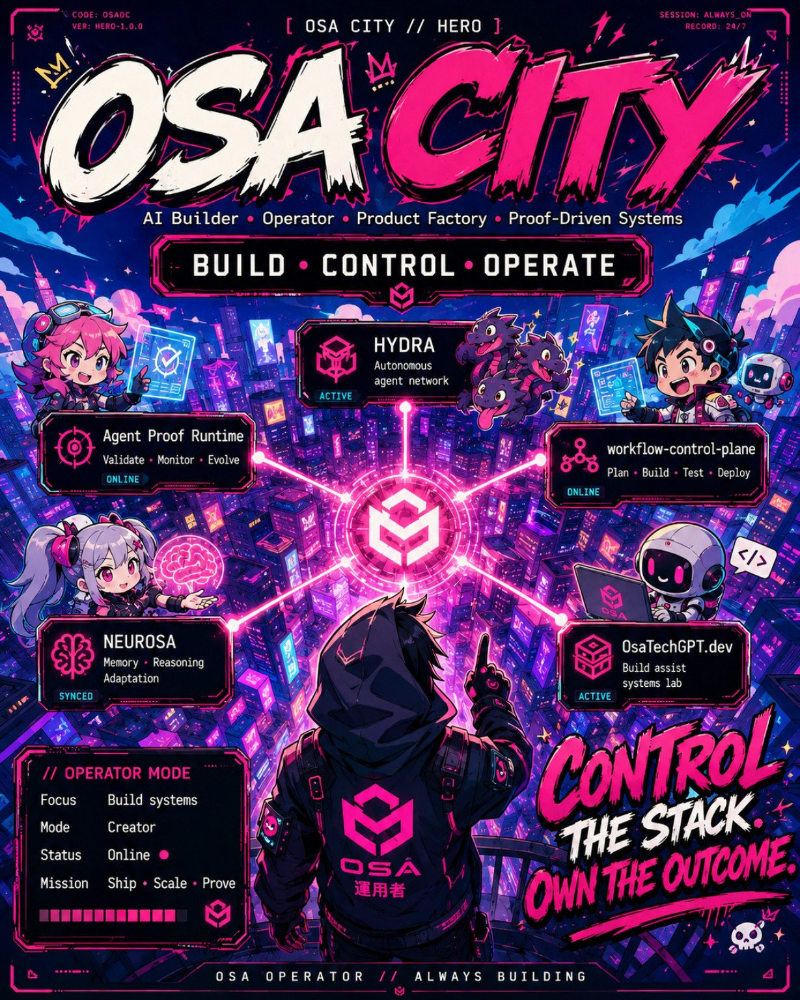
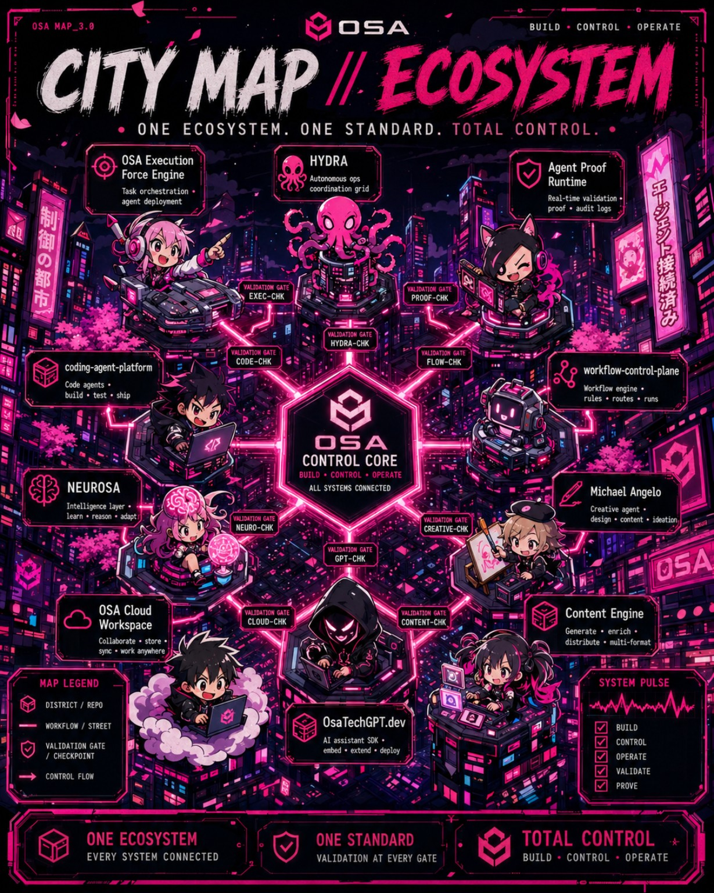
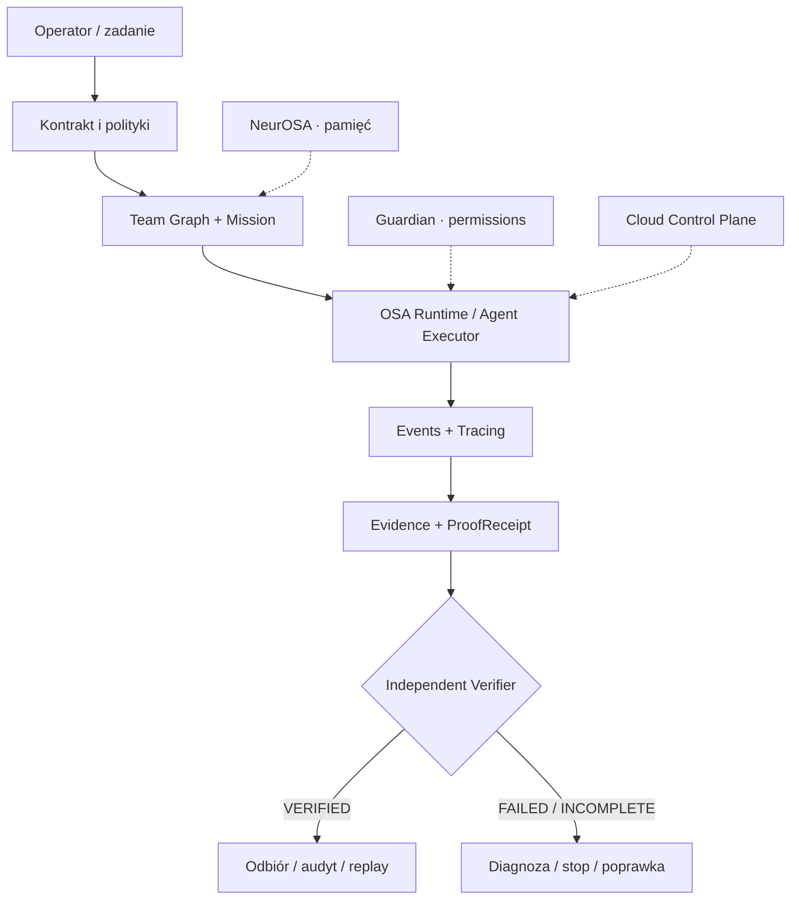
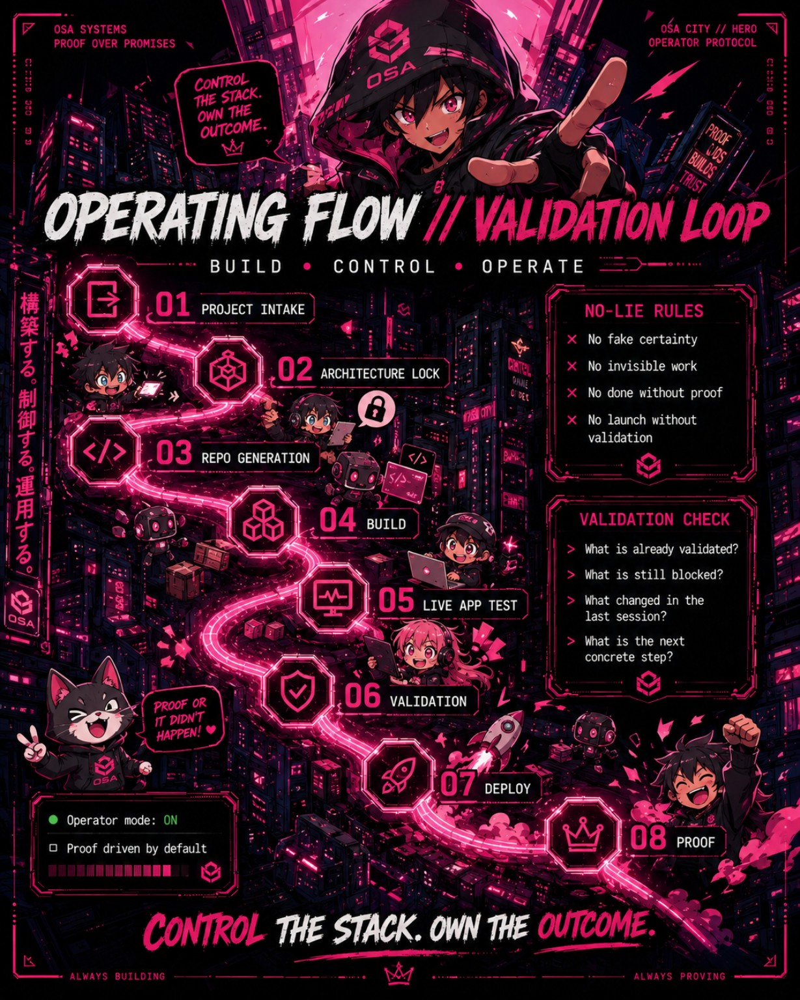
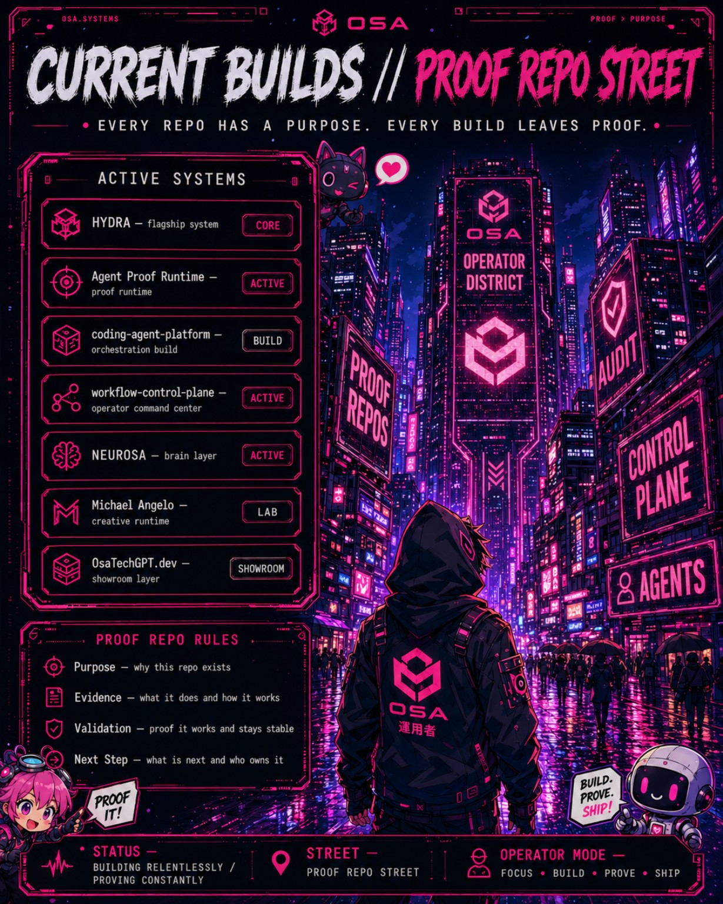
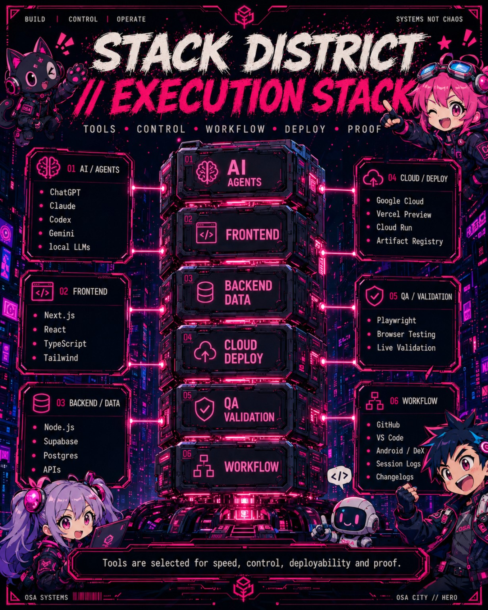

<!--
  OSA / HazEOskA — PROFILE README v2.0
  TARGET: github.com/HazEOskA/HazEOskA/README.md
  STATUS: PUBLISHED PROFILE — GitHub main (19.10.2026).
  Brand: CARBON #0D1117 · WASP GOLD #FFD700 · EMERALD #00E676
  Design contract: istniejące assets są używane od razu; nowe grafiki dopiero po dodaniu plików.
  Evidence contract: status projektu ≠ status produkcyjny; link do repo ≠ dowód E2E.
-->

<div align="center">



# BARTOSZ „OSA” OSIŃSKI

### FOUNDER · SYSTEMS ARCHITECT · AI RUNTIME ENGINEER

**O S A — Operational Systems Architecture**  
*Projektuję środowiska, w których agent nie tylko odpowiada — ale wykonuje zadania w określonych granicach, zapisuje zdarzenia i przedstawia weryfikowalne dowody.*

[](https://osatechgpt.dev/)
[](https://github.com/HazEOskA/osa-proof)
[](https://github.com/HazEOskA)
[](#doktryna-inżynieryjna)

**[🌐 OsaTechGPT](https://osatechgpt.dev/)** · **[💻 Engineering Portfolio](https://devops-portfolio-sage.vercel.app/)** · **[🧾 OSA Proof](https://github.com/HazEOskA/osa-proof)**

</div>

<p align="center">
  
</p>

<!--
  ASSET #1 / OPCJONALNA NOWA WERSJA HERO: assets/hero.png (1600x400)
  Prompt: Cinematic dark technology banner, matte carbon #0D1117. Wasp-inspired
  honeycomb city made of emerald #00E676 circuitry, terminals and data towers;
  tallest spire highlighted in gold #FFD700 with small symbolic crown. Volumetric
  light, deep perspective, engineered futuristic atmosphere, no text, 4:1.
  Gdy grafika będzie dostępna, zastąp wyłącznie ścieżkę powyższego obrazu.
-->

```text
$ whoami
  → Bartosz Osiński · HazEOskA · OsaTechGPT
$ design_principle
  → CONTRACT → EXECUTION → EVIDENCE → VERIFICATION
$ release_gate
  → NO EVIDENCE ≠ PASS
$ engineering_mode
  → READ → AUDIT → PLAN → APPROVAL → EXECUTE → VERIFY
```

> **Nie buduję kolejnego chatbota. Buduję warstwę wykonywania, nadzoru i weryfikacji pracy agentów AI.**

---

## Ekosystem OSA

**To nie jest jedna aplikacja ani pojedynczy framework.** OSA obejmuje runtime agentów, pamięć, kontrolę dostępu, analitykę, automatyzację, narzędzia dla operatora i odrębną warstwę dowodową. Projekty mają różne poziomy dojrzałości — tabela poniżej nie jest deklaracją, że wszystkie działają produkcyjnie.

<p align="center">
  
</p>

<!--
  ASSET #2 / ALTERNATYWNA MAPA: assets/osa-architecture.png (1600x900)
  Prompt: Isometric futuristic blueprint of OSA agent operating system, central
  tower "OSA CORE", six satellite platforms for security, research, cloud,
  production, learning and proof, glowing emerald energy connections and fine
  gold circuits, deep navy technical grid, clean engineering diagram.
  Labels large/readable only; no dense microtext.
-->

| Warstwa / produkt | Co rozwiązuje | Repo / materiał |
|:--|:--|:--|
| **🐝 OSA CORE** | Kernel pracy, organizer, misje, polityki, narzędzia i moduły: Prompt God, Lead Engine, Global Research, Radar | **[HazEOskA/OSA](https://github.com/HazEOskA/OSA)** |
| **🧾 OSA Proof** | Team Graph → mission → runtime → tracing → evidence → `ProofReceipt` → verifier | **[osa-proof](https://github.com/HazEOskA/osa-proof)** |
| **⚙️ APR / Agent Proof Runtime** | Kontrakty wykonania, odbiór i niezależna weryfikacja pracy agenta | **[agent-proof-runtime](https://github.com/HazEOskA/agent-proof-runtime)** |
| **🧠 NeurOSA** | Docelowo: wspólna, trwała pamięć dla agentów przez connector i Brain API | *Integracja rozwijana; bhttps://github.com/HazEOskA/neurosa-human-brain |
| **☁️ Cloud Workspace** | Jeden pulpit operatora dla infrastruktury, testów, kosztów i ścieżki deployu | **[osa-cloud-workspace](https://github.com/HazEOskA/osa-cloud-workspace)** |
| **🛡️ Guardian OS** | Multi-agent analysis, decyzje, strategia i kontrola ryzyka | **[guardian-os](https://github.com/HazEOskA/guardian-os)** |
| **🕵️ Sherlock OSA** | OSINT na danych publicznych, korelacja źródeł, evidence graph i raporty | **[Sherlock OSA](https://github.com/HazEOskA/OSINT-AGENT-SHERLOCK-OSA)** |
| **🎓 OSA Academy** | Edukacja od podstaw do samodzielnego budowania systemów AI | **[osa-academy](https://github.com/HazEOskA/osa-academy)** · repo utworzone, produkt w przygotowaniu |
| **🔧 Execution Force** | Rejestr umiejętności, uprawnienia, adaptery i operacje agentów | **[osa-execution-force-skills](https://github.com/HazEOskA/osa-execution-force-skills)** |
| **🌍 Agent World** | Eksperymenty i narzędzia agentowe dla Web3 | **[osa-agent-world](https://github.com/HazEOskA/osa-agent-world)** |

**Hydra / Jeverson / Production OS** należą do szerszej mapy prac, ale ich wewnętrznych repozytoriów nie przedstawiam jako publicznych.

---

## Architektura: od zadania do dowodu

Poniższy schemat przedstawia **docelowy przepływ architektoniczny**. Nie jest deklaracją, że wszystkie integracje z zewnętrznymi modelami przeszły test produkcyjny end-to-end.



```text
MISSION       — co ma zostać wykonane?
RUN           — która instancja i który wykonawca?
EVENTS        — co wydarzyło się podczas wykonania?
EVIDENCE      — jakie artefakty potwierdzają wynik?
PROOF RECEIPT — jaki jest zakres dowodu i wynik weryfikatora?
VERDICT       — VERIFIED / FAILED / INCOMPLETE / UNKNOWN
```

**Model może zaproponować rezultat. Nie może sam przyznać sobie wiarygodnego PASS.** Hash i `ProofReceipt` pomagają wykazać integralność oraz historię zarejestrowanych artefaktów — nie gwarantują prawdziwości dowolnego twierdzenia modelu.

<p align="center">
  
</p>

---

## Proof Board — CLAIM ≠ PROOF

Zamiast procentów sukcesu bez metodologii: **odsyłam do kodu, dokumentacji, testów i rzeczywistych ograniczeń**. Statusy odnoszą się do publicznych materiałów dostępnych przy przygotowaniu tego README, nie do ponownie wykonanych tutaj testów.

| Obszar | Co można sprawdzić | Status opisany w źródłach |
|:--|:--|:--|
| **OSA Core** | Kernel, API, runtime, organizer, testy i workflow CI | Kod oraz instrukcja uruchomienia dostępne |
| **OSA Proof** | Schemat `ProofReceipt`, fixture, release gates, audyt, sample bundle | `v0.1.0` — **BLOCKED** na wymaganych bramkach pełnego wydania |
| **Sherlock OSA** | Kod źródeł OSINT, policy gates, dokumentacja i workflow CI | Publiczne repo i dokumentacja |
| **OSA Academy** | Repo nowego produktu edukacyjnego | **EARLY** — repo bez opublikowanego README |
| **OSA ARCADE** | Samodzielny plik HTML5 z trzema trybami | **LOCAL PROTOTYPE** — bez zweryfikowanego GitHub Pages |

🔎 **Najważniejszy artefakt:** [OSA Proof — release gates i ograniczenia](https://github.com/HazEOskA/osa-proof/blob/release/osa-proof-v0.1.0/docs/release-v0.1.0/BRAMKI.md) · [Przykładowy evidence bundle](https://github.com/HazEOskA/osa-proof/blob/release/osa-proof-v0.1.0/docs/evidence/release-v0.1.0/preview-open-desktop-bundle.json) · [Kod OSA Core](https://github.com/HazEOskA/OSA)

<p align="center">
  
</p>

---

## Doktryna inżynieryjna

<!--
  ASSET #3 / OPCJONALNY MANIFEST: assets/doctrine.png (1200x600)
  Prompt: Massive ancient stone tablet with subtle engraved PCB circuitry,
  golden wasp seal at top, emerald light from below, floating in deep-black
  atmospheric cyberpunk void; dramatic and restrained, no typography.
-->

```yaml
contract_first: true         # wymagania i granice przed kodem
human_approval: required     # mutacje i deploye nie wynikają z samej rozmowy
least_privilege: true        # minimalne uprawnienia i separacja sekretów
anti_drift: default          # kontrola zakresu i zmian kontraktu
claim_is_not_proof: true     # deklaracja nie jest dowodem wykonania
evidence_before_pass: true  # brak dowodu oznacza UNKNOWN, nie sukces
rollback_and_replay: design  # odtwarzalność oraz kontrolowany powrót
cloud_portability: goal     # architektura nie powinna wiązać z jednym dostawcą
```

**Pipeline:** `READ → EVIDENCE → PLAN → APPROVAL → EXECUTE → VERIFY → STOP`

> *System ma być audytowalny również wtedy, gdy agent się myli, model zawodzi albo integracja jest niedostępna.*

---

## 🕹️ OSA ARCADE — trzy gry, jeden bohater

<div align="center">

### 🐝 NAPAKOWANA OSA

**Bicepsy. Sześciopak. Skrzydła. Żądło. Zero taryfy ulgowej.**

[](#gry-i-sterowanie)
[](#gry-i-sterowanie)
[](#gry-i-sterowanie)

`HTML5 Canvas` · `JavaScript` · `WebAudio` · `localStorage` · `0 dependencies`

**STATUS: IMPLEMENTACJA HTML5 · TEST PRZEGLĄDARKOWY NIEPOTWIERDZONY · BRAK PUBLIKACJI**

</div>

<!--
  ASSET #4 / PLANOWANY SPRITE SHEET: assets/wasp-hero.png (1600x400)
  Prompt: Legendary game mascot sheet, original muscular cartoon wasp with
  massive flexed biceps, yellow-and-black six-pack torso, angry small eyes,
  translucent buzzing wings, red stinger, dripping golden honey aura and
  emerald green rim-light, deep carbon background, 90s fighting-game character
  select, CRT scanlines. Three action poses: flight / sprint / chomping.
  No text. Sprite-friendly separated silhouettes.
-->

<!--
  ASSET #5 / PLANOWANY TRIPTYCH: assets/arcade-triptych.png (1600x500)
  Prompt: Three-panel cohesive retro arcade poster separated by luminous gold
  frames: (1) buff wasp flapping between green honeycomb columns; (2) same wasp
  sprint-jumping past spiky plants beneath gold crescent moon; (3) wasp
  collecting honey dots in emerald neon maze chased by red and blue ghosts.
  80s CRT grain / scanlines, black-gold-emerald, dynamic crisp composition,
  no readable text.
-->

### Gry i sterowanie

| Tryb | Zasada | Sterowanie desktop |
|:--|:--|:--|
| **🐝 OSO-FLAPPY** | Lecisz między miodowymi przeszkodami, zdobywasz punkty za minięte plastry | `1` → `SPACJA` / `↑` |
| **🦖 OSA-RUNNER** | Nocny sprint i skoki nad przeszkodami, prędkość rośnie | `2` → `SPACJA` / `↑` |
| **👑 PAC-OSA** | Zbierasz złote kropki miodu w labiryncie, unikasz dwóch duchów | `3` → `← ↑ → ↓` |

`ESC` — powrót do menu. Dźwięki generuje WebAudio, a osobiste rekordy zapisuje przeglądarka przez `localStorage`.

**Uruchomienie prototypu:** pobierz plik `OSA-ARCADE-Flappy-Dino-Pac-Osa-napakowana-osa.html` z paczki gry i otwórz w przeglądarce obsługującej Canvas. Nie wymaga bibliotek ani builda. Dostępność `localStorage` w trybie `file://` zależy od przeglądarki; w razie blokady uruchom prosty serwer lokalny. Sterowanie dotykowe wymaga dopracowania, szczególnie w PAC-OSA.

**Dlaczego brak przycisku „GRAJ TERAZ”?** Link `hazeoska.github.io/osa-arcade` nie wskazuje jeszcze potwierdzonego wdrożenia. Przycisk powinien pojawić się dopiero po publikacji repo, GitHub Pages i teście na desktopie oraz Androidzie.

**Następny poziom (plan, nie implementacja):** finalny sprite sheet napakowanej osy, ekran wyboru gry, poprawione sterowanie mobilne, naprawy restartów i kolizji oraz finałowy boss fight **KING GHOST** w PAC-OSA.

### 🏆 HALL OF FAME

| Gra | Rekord | Zapis |
|:--|:--:|:--|
| OSO-FLAPPY | *lokalny* | `osa_best_flappy` |
| OSA-RUNNER | *lokalny* | `osa_best_dino` |
| PAC-OSA | *lokalny* | `osa_best_pac` |

*Brak globalnego leaderboardu. Wyniki nie są synchronizowane pomiędzy urządzeniami.*

### 🐍 Bonus Round — Snake vs Commits

<!--
  ASSET #6 / PLANOWANY ARCADE SNAKE: assets/snake.png (1600x400)
  Prompt: A luminous emerald pixel-snake eating golden contribution squares
  inside a GitHub-like dark contribution grid. Retro arcade cabinet marquee,
  restrained pixel clouds, CRT scanlines, high contrast, no text.
-->

Snake w formie animowanej siatki commitów może wrócić tutaj po odtworzeniu gałęzi generującej SVG. Wskazana wcześniej ścieżka `HazEOskA/HazEOskA:output/github-contribution-grid-snake.svg` nie była dostępna przy przygotowaniu README — dlatego nie wstawiam niedziałającej grafiki.

---

## Stack & sposób budowania

<div align="center">


</div>

```text
PROJECT INTAKE
    ↓
MARKET ANGLE → FEATURE MAP → DESIGN DIRECTION
    ↓
ARCHITECTURE LOCK
    ↓
REPO → BUILD → TEST → CODE REVIEW
    ↓
DEPLOY (APPROVED) → POST-DEPLOY VALIDATION
    ↓
LAUNCH PACK → CHANGELOG / DECISIONS
```

**Ważne:** stack pokazuje technologie używane lub rozwijane w różnych częściach ekosystemu. Nie wszystkie narzędzia występują w każdej aplikacji. Docelowo rozwiązania mają być przenośne między chmurami i własną infrastrukturą.

---

## 📚 Półka inżyniera

<!--
  ASSET #7 / PLANOWANA BIBLIOTEKA: assets/library.png (1600x500)
  Prompt: Epic nocturnal technical library, floor-to-ceiling shelves,
  hovering open books emitting emerald and golden symbols, one warm desk with
  a glowing terminal, realistic/cinematic painterly lighting, no text.
-->

| Temat | Książki |
|:--|:--|
| **Architektura oprogramowania** | *The Pragmatic Programmer* · *Clean Architecture* · *Designing Data-Intensive Applications* |
| **Systemy i niezawodność** | *Site Reliability Engineering* · *The Phoenix Project* · *Thinking in Systems* |
| **AI & modele** | *Build a Large Language Model (From Scratch)* · *Artificial Intelligence: A Modern Approach* |
| **Skupienie & produkt** | *Deep Work* · *The Lean Startup* · *Zero to One* |

**Własne pisanie:** *Na nasz obraz* — autorski projekt książkowy związany z technologią, AI i człowiekiem. Informacje o publikacjach i artefaktach podaję osobno, gdy są dostępne do sprawdzenia.

> *Książka bez notatek to tylko dekoracja regału. Kod bez dowodu jest tylko deklaracją.*

---

## Telemetria GitHub

<div align="center">

<a href="https://github.com/HazEOskA">
  
</a>
<a href="https://github.com/HazEOskA?tab=repositories">
  
</a>

<sub>Widżety pochodzą z usług zewnętrznych. Nie są raportami jakości kodu ani weryfikacją wykonania.</sub>

</div>

---

## Współpraca / kontakt

Buduję technologie dla środowisk, gdzie liczą się **kontrola wykonywania, integracje z realnymi narzędziami, bezpieczeństwo, odtwarzalność oraz jasne kryteria odbioru**.

Jeśli interesują Cię systemy agentowe AI, runtime governance, MCP, automatyzacja workflow lub dowody wykonania — przejrzyj repozytoria i porównaj obietnice z kodem.

<div align="center">

<p align="center">
  
</p>

<!--
  ASSET #8 / OPCJONALNY FINAŁ: assets/castle.png (1600x400)
  Prompt: Majestic futuristic carbon-black fortress on a hill at night,
  walls made from large server racks and subtle honeycomb cells, emerald
  windows, one powerful golden beacon, volumetric mist, deep star field,
  high-end cyberpunk engineering concept art, no words.
-->

### OSA — BUILD. VERIFY. OPERATE.

[](https://osatechgpt.dev/)
[](https://devops-portfolio-sage.vercel.app/)
[](https://github.com/HazEOskA?tab=repositories)

**„Sprawdź, nie wierz.”** 🐝


</div>

<!--
  RELEASE CHECKLIST (NIE RENDERUJE SIĘ NA GITHUBIE)
  [ ] Sprawdzić render na desktopie oraz Androidzie.
  [ ] Zweryfikować poprawność assetów / badge SVG i widżetów.
  [ ] Przygotować 8 nowych grafik na podstawie notatek ASSET #1–#8.
  [ ] OSA ARCADE: utworzyć repo tylko po akceptacji, wrzucić HTML, naprawić sterowanie, przetestować, dopiero wtedy wstawić live URL.
  [ ] Snake: przywrócić workflow/branch output i zweryfikować SVG przed wstawieniem.
  [ ] Odświeżyć Proof Board na podstawie aktualnych testów/raportów CI.
  [ ] Review SEO profilu i weryfikacja portfolio docelowego.
  [ ] Nie commitować / nie pushować / nie deployować bez osobnej zgody użytkownika.
-->